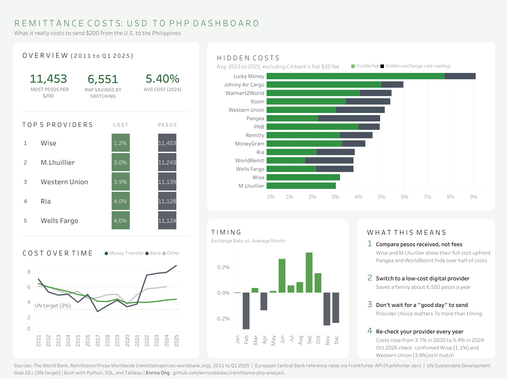

# Remittance Timing & Provider Cost Analysis (USD to PHP)

**[View Interactive Dashboard](https://public.tableau.com/views/RemittanceCostsUSDtoPHP/PHP-ANALYSIS?:language=en-US&publish=yes&:sid=&:redirect=auth&:display_count=n&:origin=viz_share_link)**


**An analytics project to help U.S. immigrant families understand where their money goes when sending it home to the Philippines.**

## Why This Project

My family regularly sends money to relatives in the Philippines. Like many families, they usually pick a provider out of habit or convenience, without knowing how much is lost to fees and exchange rate markups. A provider advertising "no fees" can still deliver fewer pesos than one that charges a visible fee, because the real cost is hidden in the exchange rate.

This project turns that into a data question and gives families a simple, clear answer.

## Business Questions

1. **Which provider delivers the most pesos per $200 sent**, after all fees and exchange rate markups?
2. **How much is hidden?** How much of each provider's cost is the visible fee vs. the exchange rate margin?
3. **Banks vs. digital providers:** Is one type consistently cheaper?
4. **Does timing matter?** Does the day of the week or month change how many pesos arrive?
5. **What's it worth?** How many pesos per year does a family save by switching from the worst provider to the best?

## Key Metric

**Pesos received per $200 sent**

```
pesos_received = 200 × (1 − total_cost_% / 100) × mid_market_exchange_rate
```

`total_cost_%` combines the transfer fee and the exchange rate margin, so every provider is compared on what the family actually receives.

## Data Sources

| Source | What it provides |
|---|---|
| [Frankfurter API](https://frankfurter.dev/) (European Central Bank rates) | Daily USD/PHP mid-market exchange rate |
| [FRED](https://fred.stlouisfed.org/series/FXRATEPHA618NUPN) | Long-run annual PHP per USD exchange rate |
| [Bangko Sentral ng Pilipinas](https://www.bsp.gov.ph/statistics/external/day99_data.aspx) | Official Philippine peso reference rate |
| [World Bank Remittance Prices Worldwide](https://remittanceprices.worldbank.org/data-download) | Fees, exchange rate margins, and total cost by provider |

## Tools

- **Python** (pandas, requests): data collection, cleaning, analysis
- **SQL** (SQLite): data storage, provider rankings, cost comparisons
- **Tableau**: interactive dashboard
- **Excel**: "what if I send $X per month" savings calculator

## Project Structure

```
remittance-php-analysis/
├── data/
│   ├── raw/           # Source files (not committed)
│   └── processed/     # Cleaned data
├── src/               # Python scripts
├── sql/               # Database schema and analysis queries
├── dashboard/         # Tableau files and data extracts
├── reports/           # Findings and recommendations
└── README.md
```

## Project Status

- [x] Project setup
- [x] Exchange rate data pipeline
- [x] Provider cost data cleaning
- [x] SQL database and analysis queries
- [x] Timing analysis
- [x] Tableau dashboard
- [x] Findings and family guide

## Key Findings

- **Provider choice matters most.** The cheapest provider delivered 546 more pesos per $200 than the costliest mainstream option, about 6,550 pesos a year.
- **Costs hide in the exchange rate.** Pangea and WorldRemit hide over half their cost in the rate; Wise and M.Lhuillier show almost all of it upfront.
- **Timing barely matters.** The best month beats the worst by only about 72 pesos, and the pattern isn't statistically reliable.
- **Costs are rising.** The average fell from 6.6% (2011) to 3.7% (2020), then rose to 5.4% (2024), above the UN's 3% target.
- **Verified in 2026.** A live price check in October 2026 matched the World Bank figures for Wise and Western Union.

Full write-up: [reports/findings.md](reports/findings.md)

## Limitations

**Data coverage**
- World Bank provider data ends in **Q1 2025**, the most recent release available as of October 2026.
- **4 of 57 quarters** are missing from the World Bank survey between 2011 and Q1 2025.
- Only providers surveyed by the World Bank are included; some popular options (e.g., PayPal, GCash-linked services) appear only in the 2026 spot check or not at all.

**Measurement**
- World Bank figures are **quoted prices** for a $200 transfer, not actual transactions. Real costs may differ for other amounts, payment methods, or delivery options.
- **8 quotes were non-transparent**: the provider did not disclose its exchange rate, so their recorded 0% markup likely understates the true cost.
- **Promotions and first-transfer discounts** are not captured in the World Bank data.
- Pesos received are estimated using the **quarterly average** mid-market rate, which smooths out movements within each quarter.

**Analysis choices**
- **Citibank** was excluded from the Hidden Costs chart because its $35 flat fee (17.5% of $200) distorts the scale. It remains in all other figures.
- Provider names were standardized (e.g., TransferWise and Wise merged) to avoid double counting.
- The **timing analysis** uses daily exchange rates, which are autocorrelated, so daily ANOVA p-values overstate certainty. The year-by-year check leaves only 15 independent observations, and the monthly pattern was not statistically significant (sign test p ≈ 0.15).

**2026 spot check**
- Based on **one day** (October 14, 2026), **5 providers**, and **one source** (Wise's public comparison page). Wise is a competitor of the providers it compares, so figures should be verified directly with each provider.
- Remitly's quote likely reflects **promotional pricing**.

## Author

**Enrico Ong**, Statistical Data Science, University of Connecticut